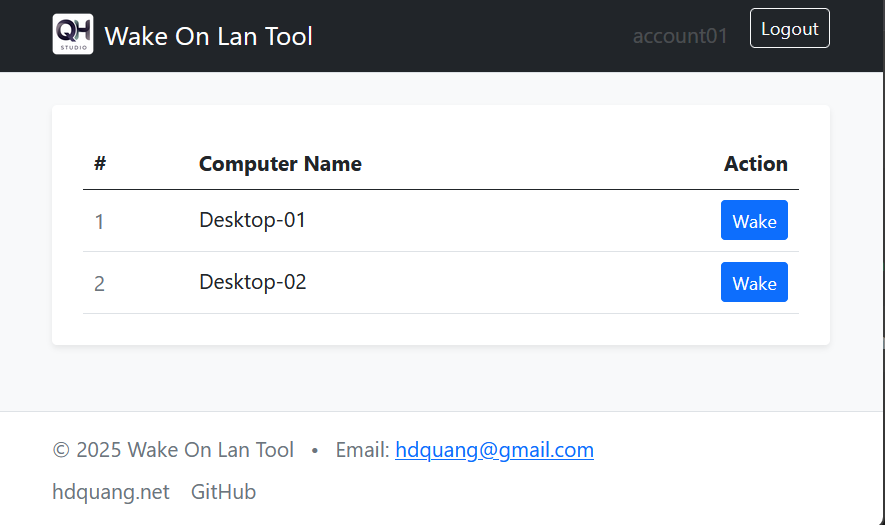

# Wake On Lan

A minimal, multi-project .NET 8 solution that lets you wake PCs on your network (Wake-on-LAN) in two ways:

- Console App: a CLI for scripting/automation.
- Web App: provides a browser-based interface for Wake-on-LAN

# Usage Console App

You can use the **CLI tool** to send Wake-on-LAN packets from a terminal or script.

```bash
WakeOnLan <option>
```
## Options
```
Option	Description
-I      <ip>  	          IP address of the destination computer.
-S      <subnet>  	      Subnet mask of your network.
-IB     <ip broadcast>    Broadcast IP of the destination computer.
-M      <mac address> 	  MAC address of the destination computer.
```
## Examples:
### 1.Send WOL using only MAC (auto-detect network)
```bash
$ WakeOnLan -M 00-1A-2B-3C-4D-5E
```
### 2.Send WOL using IP and subnet mask
```bash
$ WakeOnLan -I 192.168.1.100 -S 255.255.255.0 -M 00-1A-2B-3C-4D-5E
```
### 3.Send WOL using broadcast IP
```bash
$ WakeOnLan -IB 192.168.1.255 -M 00-1A-2B-3C-4D-5E
```
## Expected output:
```bash
The wake-on-lan packet was successfully sent to IP = 192.168.1.255, MAC = 00-1A-2B-3C-4D-5E
```

# Usage Web App (WakeOnLan.WebApp)

The Web App provides a browser-based interface for Wake-on-LAN, built on ASP.NET Core (.NET 8).



It allows authenticated users to:
- Sign in using account/password defined in configuration
- View a list of computers assigned to their account
- Send Wake-on-LAN magic packets by computer name
- Never expose MAC addresses or IP information to the UI

The Web App internally calls the shared WakeOnLan.Core library.

## Web App Configuration (appsettings.json)

The Web App reads its configuration from the WakeOnLan section.

### Example configuration
```json
{
  "Urls": "http://0.0.0.0:5095",
  "WakeOnLanConfig": {
    "Accounts": {
      "account01": {
        "ComputerList": {
          "Desktop-01": {
            "MacAddress": "AA:BB:CC:DD:EE:GG",
            "IpBroadcast": "",
            "IpAddress": "192.168.1.2",
            "SubNetMask": "255.255.255.0"
          },
          "Desktop-02": {
            "MacAddress": "AA:BB:CC:DD:EE:GG",
            "IpBroadcast": "192.168.1.255",
            "IpAddress": "",
            "SubNetMask": ""
          }
        },
        "Password": "password"
      },
      "account02": {
        "ComputerList": {
          "Desktop-01": {
            "MacAddress": "AA:BB:CC:DD:EE:GG",
            "IpBroadcast": "",
            "IpAddress": "192.168.1.4",
            "SubNetMask": "255.255.255.0"
          }
        },
        "Password": "password"
      }
    }
  }
}
```
### Configuration fields

| Field                | Description                                               |
| -------------------- | --------------------------------------------------------- |
| `Accounts`           | Dictionary of login accounts                              |
| `Password`           | Account password (plain text – intended for internal use) |
| `ComputerList`       | Computers available to this account                       |
| `ComputerName` (key) | Display name shown in the UI                              |
| `MacAddress`         | MAC address used to send the magic packet                 |
| `IpBroadcast`        | Broadcast IP (recommended)                                |
| `IpAddress`          | Target IP (informational / optional)                      |
| `SubNetMask`         | Subnet mask (optional)                                    |

Security note:
- Passwords are stored in plain text and should only be used in trusted environments (LAN, VPN, or behind a severse proxy).

### Deploying on Ubuntu (systemd service)
1. Create application directory
   ```bash
   sudo mkdir /opt/wakeonlan
   ```
2. Copy published files
    ```bash
    unzip WakeOnLan.WebApp.zip
    sudo cp -r WakeOnLan.WebApp/* /opt/wakeonlan/
    sudo chmod +x /opt/wakeonlan/WakeOnLan.WebApp
    ```
3. Edit appsettings.json
    ```bash
    sudo nano /opt/wakeonlan/appsettings.json
    ```
    - Enter information such as account and computer.
4. Create systemd service
    ```bash
    sudo nano /etc/systemd/system/wakeonlan.webapp.service
    ```
    - Framework-dependent
    ```ini
    [Unit]
    Description=Wake On Lan Tool Web App
    After=network.target

    [Service]
    Type=simple
    User=ubuntu
    WorkingDirectory=/opt/wakeonlan
    Environment=ASPNETCORE_ENVIRONMENT=Production
    ExecStart=/usr/bin/dotnet /opt/wakeonlan/WakeOnLan.WebApp.dll
    Restart=always
    RestartSec=3

    NoNewPrivileges=true
    PrivateTmp=true
    ProtectSystem=full

    [Install]
    WantedBy=multi-user.target
    ```

    - Self-contained
    ```ini
    [Unit]
    Description=Wake On Lan Tool WebApp
    After=network.target

    [Service]
    Type=simple
    User=ubuntu
    WorkingDirectory=/opt/wakeonlan
    Environment=ASPNETCORE_ENVIRONMENT=Production

    ExecStart=/opt/wakeonlan/WakeOnLan.WebApp

    Restart=always
    RestartSec=3

    NoNewPrivileges=true
    PrivateTmp=true
    ProtectSystem=full

    [Install]
    WantedBy=multi-user.target
    ```

5. Enable and start service
    ```bash
    sudo systemctl daemon-reload
    sudo systemctl enable wakeonlan.webapp.service
    sudo systemctl start wakeonlan.webapp.service
    ```
6. Access the tool
   - Open the browser and access url `http://[ipserver]:5095`
### Security Recommendations

- Use the Web App only on:
  - Internal LAN
  - VPN
  - Or behind a reverse proxy
- Do not expose directly to the public internet without additional protection
- Consider adding:
  - Reverse proxy authentication
  - IP allowlist
  - HTTPS (Nginx + Let’s Encrypt)

# Features

- Send Wake-on-LAN (WOL) Magic Packets (UDP, port 9 by default).

- Accepts MAC in common formats: `AA:BB:CC:DD:EE:FF`, `AA-BB-CC-DD-EE-FF`, `AABBCCDDEEFF`.

- Choose broadcast IP (e.g., `192.168.1.255` or `255.255.255.255`) and port.

- Reusable Core library:

  - `WakeOnLanClient.SendMagicPacketAsync(...)`

  - `NetUtils.ParseMac(...), NetUtils.ValidateIP(...)`

  - `NetUtils.GetDefaultInterface(...)` to discover the system’s default NIC & local IP.

# Requirements

- .NET SDK 8.0

- On the target PC you want to wake:

  - BIOS/UEFI: Enable Wake-on-LAN / “Wake on Magic Packet”.

  - OS/Driver: Enable WOL on the NIC (Power Management / Advanced tab).

  - The machine must have standby power available (S3/S4/S5 support varies by hardware).

# Tips & Notes

- Broadcast IP choice matters. Many routers block global `255.255.255.255`. Prefer your subnet broadcast, e.g., `192.168.0.255 / 10.0.1.255`.

- Firewall: Allow outbound UDP to the chosen port (typically 9 or 7). Some setups also require allowing directed broadcast on the router.

- Multiple sends: Certain devices respond more reliably if you send the packet 2–3 times.

- Pv6: WOL is generally IPv4-centric at the packet level; the library utilities support IPv6 parsing and interface discovery, but WOL delivery typically relies on IPv4 broadcast within the LAN.

# Troubleshooting

### Target doesn’t wake:

- Verify WOL options are enabled in BIOS/NIC driver.

- Use the subnet broadcast IP.

- Ensure the target machine’s NIC still has power in sleep/shutdown.

- Try port 7 if 9 doesn’t work; send the packet multiple times.

### Multiple NICs / VPNs:

- Confirm which NIC is default (NetUtils.GetDefaultInterface() can help).

- If your PC and the target are on different subnets/VLANs, directed broadcast may be blocked.

# Projects

- WakeOnLan.WebApp — The Web App provides a browser-based interface for Wake-on-LAN.

- WakeOnLan.Cli — Console app for scripting/automation.

- WakeOnLan.Core — Reusable library (Wake On Lan client + network utilities).